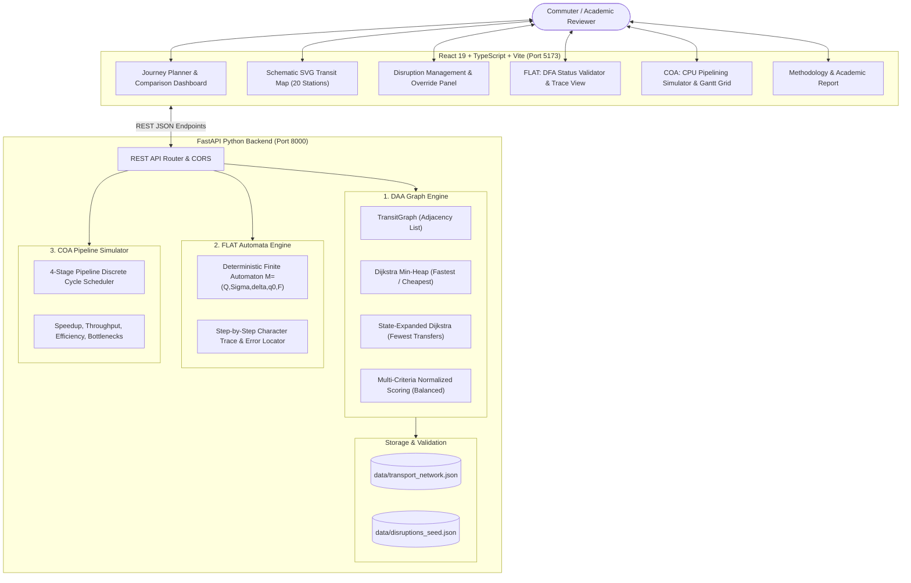

# RouteWise — Smart Public Transport Route Planning & Disruption Assistance
### An Academic Micro-Project Integrating DAA, FLAT, and COA

[](docs/TESTING_REPORT.md)
[](docs/TESTING_REPORT.md)
[](LICENSE)
[](https://python.org)
[](https://react.dev)

---

## 1. Project Overview

**RouteWise** is a full-stack public transportation planning web application designed as an academic micro-project that synthesizes three core computer science subjects into a single, cohesive software system:

1. **Design and Analysis of Algorithms (DAA):** Models a multi-modal bus and metro network as a weighted graph. Implements Dijkstra's algorithm with priority queues across four distinct user objectives: **Fastest**, **Cheapest**, **Fewest Transfers** (via state-expanded graph), and **Balanced** (normalized multi-criteria compromise). Automatically recalculates journeys when simulated disruptions occur.
2. **Formal Language and Automata Theory (FLAT):** Implements a genuine Deterministic Finite Automaton (DFA) $M = (Q, \Sigma, \delta, q_0, F)$ that validates operational transit status codes character-by-character, complete with trap states, error position localization, and visual state traces.
3. **Computer Organization and Architecture (COA):** Models the computational execution of transit route planning requests across a 4-stage processing pipeline (`IF_PREP`, `VAL`, `ROUTE`, `WB_RES`). Simulates cycle-accurate execution, generates Gantt charts, identifies structural bottlenecks, and measures speedup, throughput, and efficiency.

> **Notice:** All transportation routes, fares, travel durations, and disruption events in this application operate on a self-contained synthetic metropolitan transit dataset.

---

## 2. Problem Statement & Proposed Solution

### Problem Statement
Urban commuters must constantly weigh conflicting trade-offs between travel time, out-of-pocket fares, and the inconvenience of changing vehicles. Furthermore, unannounced track works, road maintenance, and mechanical failures suddenly invalidate regular journeys, leaving passengers stranded without transparent alternatives.

### Proposed Solution
RouteWise provides an interactive mobility platform that:
- Models public transit as a weighted graph with multi-modal edges.
- Calculates and presents 4 distinct journey alternatives simultaneously.
- Simulates network disruptions and dynamically reroutes passengers around affected corridors.
- Formally verifies transit telemetry and status codes using automata theory.
- Demonstrates how query processing workloads execute on microarchitectures using CPU pipelining simulation.

---

## 3. System Architecture



---

## 4. Subject-Wise Integration Details

### 4.1 Design and Analysis of Algorithms (DAA)
- **Graph Topology:** Directed graph $G = (V, E)$ with 20 stations, 48 directed edges, 3 metro lines (Red M1, Blue M2, Green M3), and 4 bus routes (Route 101, 204, 305, 408).
- **Non-Negativity Constraint:** Every edge weight $w(e) \ge 0$. Strictly enforced by Pydantic models and graph initializers.
- **Fastest Route:** Single-Source Shortest Path (SSSP) minimizing travel duration using a binary min-heap priority queue ($O((|V| + |E|) \log |V|)$).
- **Cheapest Route:** SSSP minimizing fare cost.
- **Fewest Transfers:** Formulated on an expanded state graph $V' = V \times (L \cup \{\text{None}\})$, where states track `(station, line)`. A transfer penalty is assessed only when line identifiers change, avoiding the error of minimizing stop counts.
- **Balanced Route:** Evaluates candidate paths using normalized multi-criteria compromise:
  $$\text{Score} = 0.45 \cdot \frac{T - T_{\min}}{T_{\max} - T_{\min}} + 0.35 \cdot \frac{C - C_{\min}}{C_{\max} - C_{\min}} + 0.20 \cdot \frac{TR - TR_{\min}}{TR_{\max} - TR_{\min}}$$
- **Disruption Rerouting:** Disrupted edges/stops are omitted from the adjacency list before Dijkstra executes. If a station becomes isolated (e.g. `STN_PORT_TERMINAL` viaduct disruption), the system returns an explicit `is_feasible = False` diagnostic.

### 4.2 Formal Language and Automata Theory (FLAT)
- **Mathematical 5-Tuple:** $M = (Q, \Sigma, \delta, q_0, F)$
- **Language ($L$):** $L = \{ \text{ON\_TIME}, \text{DELAYED}, \text{CANCELLED}, \text{MAINTENANCE}, \text{DIVERTED} \}$
- **Alphabet ($\Sigma$):** Uppercase ASCII letters [A-Z] and underscore `_`.
- **States ($Q$):** Initial state $q_0$, absorbing trap state $q_{\text{trap}}$, intermediate prefix states, and 5 accepting states $F$.
- **Implementation:** Genuine character-by-character processing. Undefined inputs transition to $q_{\text{trap}}$ and pinpoint the exact character index of the rejection.

### 4.3 Computer Organization and Architecture (COA)
- **4 Pipelined Stages:**
  1. `IF_PREP`: Input & Request Preparation (parsing origin, destination, filters)
  2. `VAL`: Input Validation (station check and DFA status code verification)
  3. `ROUTE`: Route Calculation (Dijkstra graph traversal)
  4. `WB_RES`: Result Output & Formatting (path reconstruction, serialization)
- **Execution Models:**
  - Sequential: $T_{\text{seq}} = N \times \sum_{k=1}^4 d_k$ cycles.
  - Pipelined: Cycle-accurate discrete recurrence tracking stage resource constraints:
    $$\text{start}(r, k) = \max(\text{end}(r, k-1), \, \text{end}(r-1, k))$$
    $$\text{end}(r, k) = \text{start}(r, k) + d_k$$
  - Ideal unit pipeline ($d_k = 1$): $T_{\text{pipe}} = K + N - 1$ cycles.
  - Metrics: Speedup $S = T_{\text{seq}} / T_{\text{pipe}}$, Throughput $TP = N / T$, Efficiency, and structural bottleneck detection.

---

## 5. Technology Stack

- **Frontend:** React 19, TypeScript, Vite 8, Tailwind CSS, Lucide React, Vitest.
- **Backend:** Python 3.14, FastAPI, Pydantic 2, Uvicorn, Pytest, HTTPX.
- **Data Persistence:** Local JSON synthetic dataset (`data/transport_network.json` & `data/disruptions_seed.json`).
- **No external live API keys, paid cloud accounts, or third-party mapping dependencies required.**

---

## 6. Installation & Execution Instructions

### Prerequisites
- Python 3.10+ (Tested on Python 3.14)
- Node.js 18+ (Tested on Node v22.18.0)
- npm or pnpm

### 6.1 Backend Setup (Windows & macOS/Linux)

**Windows (PowerShell):**
```powershell
# Navigate to project root
cd "c:\Users\harri\MIcro Project_3in1"

# Install backend dependencies
python -m pip install -r backend/requirements.txt

# Start FastAPI backend server
python -m uvicorn backend.app.main:app --host 127.0.0.1 --port 8000 --reload
```

**macOS / Linux:**
```bash
# Navigate to project root
cd RouteWise

# Install backend dependencies
python3 -m pip install -r backend/requirements.txt

# Start FastAPI backend server
python3 -m uvicorn backend.app.main:app --host 127.0.0.1 --port 8000 --reload
```

Backend will be active at: `http://127.0.0.1:8000`  
Swagger UI documentation: `http://127.0.0.1:8000/docs`

### 6.2 Frontend Setup

```bash
# Navigate to frontend directory
cd frontend

# Install npm dependencies
npm install

# Start Vite development server
npm run dev
```

Frontend will be active at: `http://127.0.0.1:5173/`

---

## 7. Running Automated Tests

### 7.1 Backend Tests (Pytest)
From the project root:
```bash
python -m pytest backend/tests -v
```
*Expected Result:* 30 passed in < 1 second.

### 7.2 Frontend Tests (Vitest)
From the `frontend/` directory:
```bash
npm test
```
*Expected Result:* 5 passed across 3 test files.

### 7.3 Frontend Production Build
From the `frontend/` directory:
```bash
npm run build
```
*Expected Result:* Clean compilation with 0 errors.

---

## 8. Repeatable Demonstration Scenario

Follow this step-by-step checklist to demonstrate all features:

1. **Open Application:** Navigate to `http://127.0.0.1:5173/`.
2. **Fastest vs. Cheapest Trade-Off:**
   - Origin: `Central Station`, Destination: `Tech Park Hub`.
   - Click **Calculate Journeys**.
   - **Fastest Route:** Metro Red line (Duration: **6 mins**, Fare: **$20.00**, 0 transfers).
   - **Cheapest Route:** Route 101 Bus (Duration: **15 mins**, Fare: **$7.00**, 0 transfers).
   - *Educational Takeaway:* Demonstrates that algorithmic optimality depends strictly on the objective function.
3. **Inspect Schematic Map:**
   - Scroll down to review the SVG map. Observe the active route glowing in violet/cyan overlay.
   - Click on `Riverfront Promenade` on the map and choose *Set Origin* or *Set Dest*.
4. **Disruption Rerouting:**
   - Switch to the **Disruptions** tab.
   - Activate **Red Line Tunnel Maintenance (Central - Tech Park)**.
   - Return to Journey Planner and click **Calculate Journeys**.
   - Notice that the direct Metro Red path is excluded; the system reroutes passengers via the surface bus or alternate interchanges.
5. **Destination Unreachable Handling:**
   - In **Disruptions**, activate **Port Terminal Bridge Closure (Destination Unreachable)**.
   - Plan journey from `Central Station` to `Port Terminal`.
   - Result: The route card states *"No route found... Unavailable"* because the single connecting viaduct is disrupted.
   - Click **Clear All Disruptions** to restore the network.
6. **FLAT DFA Validation:**
   - Switch to **FLAT: DFA Explorer**.
   - Enter `ON_TIME` and click **Validate Token** -> State `q_ACC_ON_TIME` (**Accepted**).
   - Enter `DELAY` and click **Validate Token** -> State `q_DELAY` (**Rejected**: Incomplete prefix).
   - Enter `ON-TIME` -> State `q_trap` (**Rejected**: Illegal character at index 2).
   - Toggle **View δ Transition Table** to inspect the state machine matrix.
7. **COA Pipeline Simulator:**
   - Switch to **COA: Pipeline Sim**.
   - Set Workload Size to 8 queries. Click preset **Routing Bottleneck (1-1-5-1)**.
   - Inspect the metrics: Sequential Cycles = 64, Pipelined Cycles = 43, Speedup = 1.488x.
   - Toggle between **Pipelined Overlap** and **Sequential Execution** on the Gantt chart to observe structural pipeline stalls.

---

## 9. Academic Documentation Index

Detailed academic project submission reports are available in the [`docs/`](docs/) directory:

- [docs/PROJECT_REPORT.md](docs/PROJECT_REPORT.md): Complete academic report draft with abstract, methodology, results, and student details template.
- [docs/ALGORITHM_ANALYSIS.md](docs/ALGORITHM_ANALYSIS.md): Comprehensive DAA shortest-path graph formulations, state-expansion for transfers, and asymptotic complexity proofs.
- [docs/DFA_DESIGN.md](docs/DFA_DESIGN.md): Detailed FLAT formal 5-tuple specification, transition table, language definition, and error localization.
- [docs/PIPELINE_ANALYSIS.md](docs/PIPELINE_ANALYSIS.md): Detailed COA instruction pipelining, cycle recurrence models, throughput, speedup, and bottleneck analysis.
- [docs/API_DOCUMENTATION.md](docs/API_DOCUMENTATION.md): Complete REST endpoint documentation with JSON request/response payloads.
- [docs/TESTING_REPORT.md](docs/TESTING_REPORT.md): Testing report detailing all 35 executed tests and results.

---

## 10. Git Initialization & Repository Commands

To initialize Git, commit the project, and push to your GitHub repository:

```bash
# Initialize git repository
git init

# Add all files to staging
git add .

# Create initial commit
git commit -m "feat: complete RouteWise 3-in-1 academic micro-project (DAA + FLAT + COA)"

# Link to your remote GitHub repository
git remote add origin https://github.com/<your-username>/RouteWise.git

# Set default branch and push
git branch -M main
git push -u origin main
```

---

## 11. Known Limitations & Future Enhancements

- **Current Limitations:**
  - Uses synthetic transit data rather than live GTFS-RT APIs (by academic design to avoid runtime external dependencies).
  - Pipelining simulation is a discrete mathematical model and does not alter native host CPU hardware registers.
- **Future Enhancements:**
  - Real-time GTFS-RT protobuf ingestion.
  - Pushdown Automata (PDA) extension to parse nested multi-segment booking grammars.
  - Superscalar out-of-order execution modeling (Tomasulo algorithm).

---

## 12. License

This project is licensed under the [MIT License](LICENSE).
