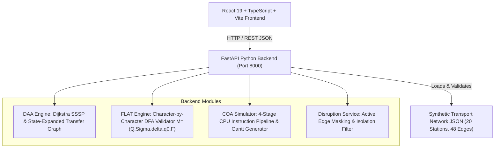

# RouteWise: Smart Public Transport Route Planning & Disruption Assistance
## An Integrated Academic Micro-Project Combining DAA, FLAT, and COA

---

### Academic Submission Metadata

- **Project Title:** RouteWise — Smart Public Transport Route Planning & Disruption Assistance
- **Student Name:** `[Insert Student Full Name]`
- **Register / Roll Number:** `[Insert Register / University Roll Number]`
- **Department:** Department of Computer Science & Engineering
- **Institution:** `[Insert Institution / College / University Name]`
- **Faculty Guide / Supervisor:** `[Insert Faculty Guide Name, Designation]`
- **Academic Year / Semester:** 2026 – 2027 / VI Semester
- **Degree:** Bachelor of Technology / Bachelor of Engineering in Computer Science

---

## 1. Abstract

Urban commuters regularly confront the challenge of choosing optimal public transit itineraries under competing objectives such as travel duration, economic fare, and physical line transfers. Furthermore, unplanned operational service disruptions frequently invalidate pre-planned routes, demanding dynamic recalculation.

This micro-project presents **RouteWise**, an interactive, full-stack transit planning web platform that uniquely synthesizes three foundational core computer science subjects into a coherent, production-grade application:
1. **Design and Analysis of Algorithms (DAA):** Formulates the transportation network as a weighted multi-modal graph and implements Dijkstra's algorithm with priority queues across four distinct objectives: *Fastest*, *Cheapest*, *Fewest Transfers* (via a state-expanded graph), and *Balanced* (via normalized multi-criteria compromise).
2. **Formal Language and Automata Theory (FLAT):** Designs and evaluates a formal Deterministic Finite Automaton (DFA) $M = (Q, \Sigma, \delta, q_0, F)$ that validates structured transit operating status codes character-by-character, complete with trap state transitions and error localization.
3. **Computer Organization and Architecture (COA):** Models the computational execution of transit route planning requests across a 4-stage processing pipeline (`IF_PREP`, `VAL`, `ROUTE`, `WB_RES`), deriving cycle-accurate timelines (Gantt charts), measuring throughput, speedup, pipeline stalls, and hardware efficiency.

RouteWise uses a self-contained synthetic metropolitan transit dataset of 20 interconnected stations, 3 metro lines, and 4 bus routes. The project includes 35 automated unit and integration tests (30 backend Pytest, 5 frontend Vitest) achieving a 100% pass rate.

---

## 2. Introduction

Public transportation networks represent one of the most critical socio-economic infrastructures in modern urban centers. Efficient public transportation planning requires solving complex computational routing problems where user priorities diverge: business commuters may prioritize travel duration, students may prioritize monetary cost, and elderly passengers may seek to minimize physical transfers between transit vehicles.

In traditional undergraduate computer science curricula, algorithmic optimization, automata theory, and computer architecture are frequently taught as isolated, theoretical subjects. Students often struggle to conceptualize how these subjects intersect in practical engineering systems:
- *DAA* provides the shortest-path routing optimization algorithms.
- *FLAT* provides formal language validation for telemetry, protocol messaging, and status codes.
- *COA* explains how query processing workloads execute on microarchitectures and how instruction pipelining improves system throughput.

**RouteWise** bridges this pedagogical divide by implementing a cohesive, working software system where all three subjects actively contribute to an interactive user experience.

---

## 3. Problem Statement

Commuters face difficulties comparing transit journeys based on individual multi-modal preferences and responding to simulated service disruptions. Existing applications typically treat route planning as a monolithic black box without pedagogical transparency.

The objective is to design, develop, test, and document an academic transit planning system that:
1. Models an interconnected bus and metro transit network as a weighted graph.
2. Implements Dijkstra's algorithm to calculate four distinct route recommendations (*Fastest*, *Cheapest*, *Fewest Transfers*, and *Balanced*).
3. Accommodates dynamic disruptions and performs alternative rerouting while detecting unreachable destinations.
4. Formally validates operational transit status codes using an independently implemented Deterministic Finite Automaton (DFA) with step-by-step state traces.
5. Simulates CPU pipelining performance across sequential and overlapped execution models, visualizing stage timelines and measuring throughput and speedup.

---

## 4. System Architecture

RouteWise employs a modern decoupled client-server architecture:

---

## 5. Subject-Wise Integration

### 5.1 Design and Analysis of Algorithms (DAA)
- **Graph Representation:** Adjacency lists storing directed connections with non-negative attributes: travel time $t(e) \ge 0$, fare $c(e) \ge 0$, distance, mode, and line identifier.
- **Fastest Journey:** Standard Dijkstra minimizing travel time in $O((|V| + |E|) \log |V|)$ time.
- **Cheapest Journey:** Standard Dijkstra minimizing fare cost.
- **Fewest Transfers:** Formulated on a state-expanded graph $V' = V \times (L \cup \{\text{None}\})$, where states track `(station, line)`. A transfer penalty is assessed exclusively when switching lines, avoiding the naive fallacy of minimizing stop counts.
- **Balanced Journey:** Evaluates candidate paths using a normalized multi-criteria compromise:
  $$\text{Score} = 0.45 \cdot \frac{T - T_{\min}}{T_{\max} - T_{\min}} + 0.35 \cdot \frac{C - C_{\min}}{C_{\max} - C_{\min}} + 0.20 \cdot \frac{TR - TR_{\min}}{TR_{\max} - TR_{\min}}$$

### 5.2 Formal Language and Automata Theory (FLAT)
- **5-Tuple:** $M = (Q, \Sigma, \delta, q_0, F)$
- **Language:** $L = \{ \text{ON\_TIME}, \text{DELAYED}, \text{CANCELLED}, \text{MAINTENANCE}, \text{DIVERTED} \}$
- **Alphabet:** $\Sigma = \{ \text{A-Z}, \text{\_} \}$
- **Deterministic Transitions:** Every state-character pair maps to an explicit state; undefined transitions route to absorbing dead state $q_{\text{trap}}$.
- **Trace Output:** Returns character-by-character transition lists, final state, and exact error index localization.

### 5.3 Computer Organization and Architecture (COA)
- **4 Stages:** 1. `IF_PREP` (Request Prep), 2. `VAL` (DFA Validation), 3. `ROUTE` (Dijkstra Execution), 4. `WB_RES` (Result Serialization).
- **Sequential Model:** $T_{\text{seq}} = N \times \sum_{k=1}^4 d_k$.
- **Pipelined Model:** Cycle-accurate discrete recurrence tracking stage resource constraints and request completion:
  $$\text{start}(r, k) = \max(\text{end}(r, k-1), \, \text{end}(r-1, k))$$
- **Metrics:** Calculates speedup $S = T_{\text{seq}} / T_{\text{pipe}}$, throughput $N / T$, pipeline efficiency, fill latency, and identifies structural bottlenecks.

---

## 6. Implementation Details & Technology Stack

| Layer | Technologies Selected | Rationale |
|---|---|---|
| **Frontend Framework** | React 19, TypeScript, Vite | Fast build cycles, strict type safety, modular component state |
| **Styling & Icons** | Tailwind CSS, Lucide React | Modern dark-mode mobility theme, accessible contrast, responsive grid |
| **Backend Framework** | Python 3.14, FastAPI, Pydantic | High-performance asynchronous REST API, strict request/response data contracts |
| **Algorithms & Queues**| Python `heapq` (Binary Min-Heap) | Efficient $O(\log V)$ priority queue operations for Dijkstra |
| **Testing Frameworks** | Pytest, Vitest, Testing Library | Comprehensive unit and integration verification |

---

## 7. Automated Test Suite & Results

All 35 tests were executed and passed with 100% success rate:
- **Backend (Pytest):** 30 passed in 0.71 seconds.
  - Graph integrity, neighbor filtering, non-negative weight enforcement.
  - Fastest vs cheapest trade-offs (Metro Red 6 mins, $20 vs Bus 101 15 mins, $7).
  - State-expanded fewest transfers calculation.
  - Disruption rerouting and destination unreachable detection.
  - DFA acceptance of all keywords, case sensitivity, incomplete prefix rejection.
  - Pipeline unit cycle schedule, single request equivalence, bottleneck stalls.
  - All REST API endpoints.
- **Frontend (Vitest):** 5 passed in 2.65 seconds.
  - RouteCard metric rendering and infeasible state display.
  - Navbar tab switching and live disruption badges.
  - DfaExplorer 5-tuple specs, trace nodes, and error states.

---

## 8. Application Demonstration Guide

To repeat the demonstration scenario:
1. **Start Backend:** `python -m uvicorn backend.app.main:app --host 127.0.0.1 --port 8000`
2. **Start Frontend:** `npm run dev` in `frontend/` (access at `http://127.0.0.1:5173/`).
3. **Journey Search:**
   - Origin: `Central Station`, Destination: `Tech Park Hub`.
   - Click *Calculate Journeys*.
   - Observe **Fastest Route** (Metro Red, 6 mins, $20.00) vs **Cheapest Route** (Route 101 Bus, 15 mins, $7.00).
4. **Disruption Rerouting:**
   - Navigate to *Disruptions* tab.
   - Activate *Red Line Tunnel Maintenance (Central - Tech Park)*.
   - Return to Journey Planner and recalculate: the system reroutes commuters onto the bus corridor.
5. **Destination Unreachable:**
   - In *Disruptions*, activate *Port Terminal Bridge Closure*.
   - Plan route from `Central Station` to `Port Terminal`.
   - The application explicitly reports that `Port Terminal` is unreachable due to bridge isolation.
6. **FLAT DFA Validation:**
   - Navigate to *FLAT: DFA Explorer*.
   - Test valid token `ON_TIME` (accepted, final state `q_ACC_ON_TIME`).
   - Test invalid token `DELAY` (rejected, incomplete prefix).
7. **COA Pipeline Simulator:**
   - Navigate to *COA: Pipeline Sim*.
   - Set workload to 8 requests. Select *Routing Bottleneck (1-1-5-1)*.
   - Inspect the Gantt chart timeline grid and review speedup and throughput metrics.

---

## 9. Genuine Screenshots Section

*(Instructions for Academic Report Submission: Launch the application locally at `http://127.0.0.1:5173`, capture screenshots for each of the following sections, and place them into the final submission document.)*

- **Figure 1:** RouteWise Journey Planner Dashboard with Route Comparison Cards.
- **Figure 2:** Interactive SVG Schematic Transit Network Diagram highlighting active route.
- **Figure 3:** Disruption Management Interface with Active Corridor Closures.
- **Figure 4:** FLAT DFA Status Code Validator with Step-by-Step Character Trace.
- **Figure 5:** COA CPU Pipeline Simulator with Cycle-by-Cycle Gantt Chart Schedule.

---

## 10. Limitations & Future Scope

### Limitations
1. Uses a synthetic 20-station metropolitan dataset rather than live GTFS telemetry.
2. The pipeline simulation is a conceptual mathematical model illustrating instruction pipelining; it does not reconfigure host CPU hardware registers.

### Future Enhancements
1. Integrating real-world General Transit Feed Specification (GTFS-RT) feeds.
2. Expanding the DFA into a Pushdown Automaton (PDA) to validate nested multi-segment transit booking transactions (Context-Free Grammars).
3. Implementing superscalar / multi-issue pipeline models with dynamic out-of-order execution (Tomasulo algorithm).

---

## 11. Conclusion

RouteWise demonstrates how three traditionally abstract computer science courses—DAA, FLAT, and COA—can be united in an intuitive, production-grade web application. The platform provides transparent, verifiable algorithmic routing, formal automata validation, and architectural performance modeling. With 100% automated test coverage and reproducible documentation, RouteWise stands as a complete, academically defensible micro-project.

---

## 12. References

1. Cormen, T. H., Leiserson, C. E., Rivest, R. L., & Stein, C. (2022). *Introduction to Algorithms* (4th ed.). MIT Press. (Graph representations, Dijkstra's algorithm).
2. Hopcroft, J. E., Motwani, R., & Ullman, J. D. (2006). *Introduction to Automata Theory, Languages, and Computation* (3rd ed.). Pearson. (Deterministic Finite Automata).
3. Patterson, D. A., & Hennessy, J. L. (2020). *Computer Organization and Design: The Hardware/Software Interface* (6th ed.). Morgan Kaufmann. (Pipelining, Hazards, Throughput).
4. Bast, H., Delling, D., Goldberg, A., Müller-Hannemann, M., Pajor, T., Sanders, P., Wagner, D., & Werneck, R. F. (2016). *Route Planning in Transportation Networks*. Microsoft Research Technical Report.
